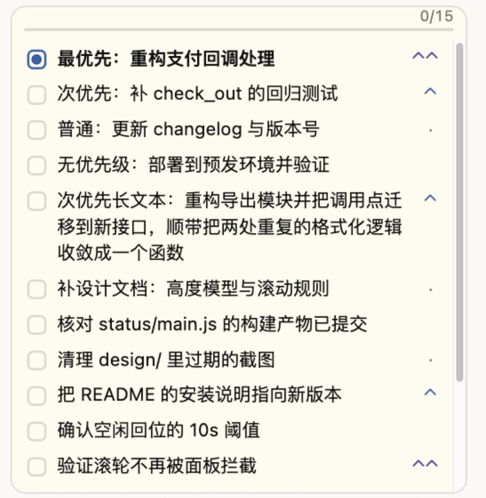
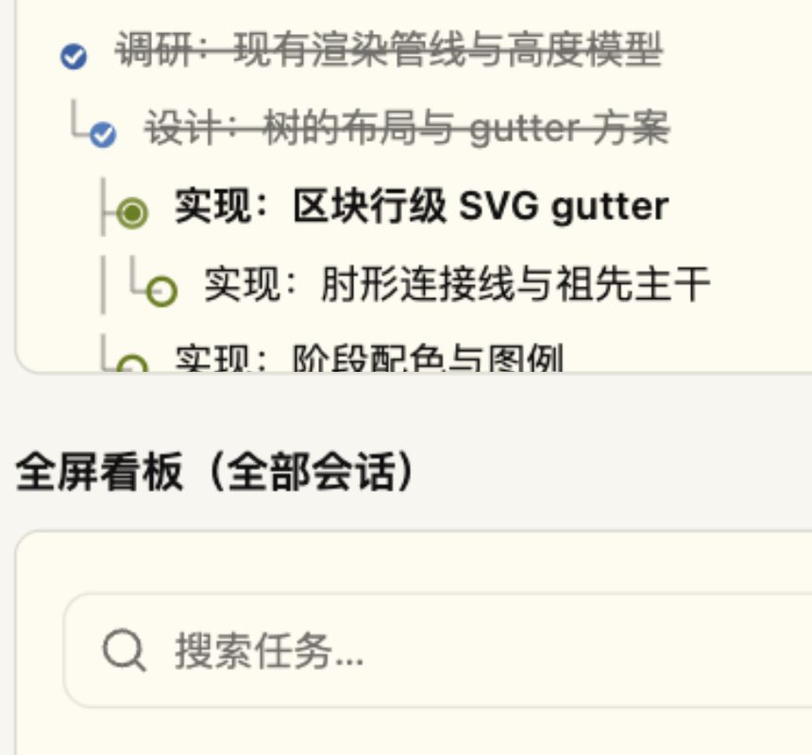
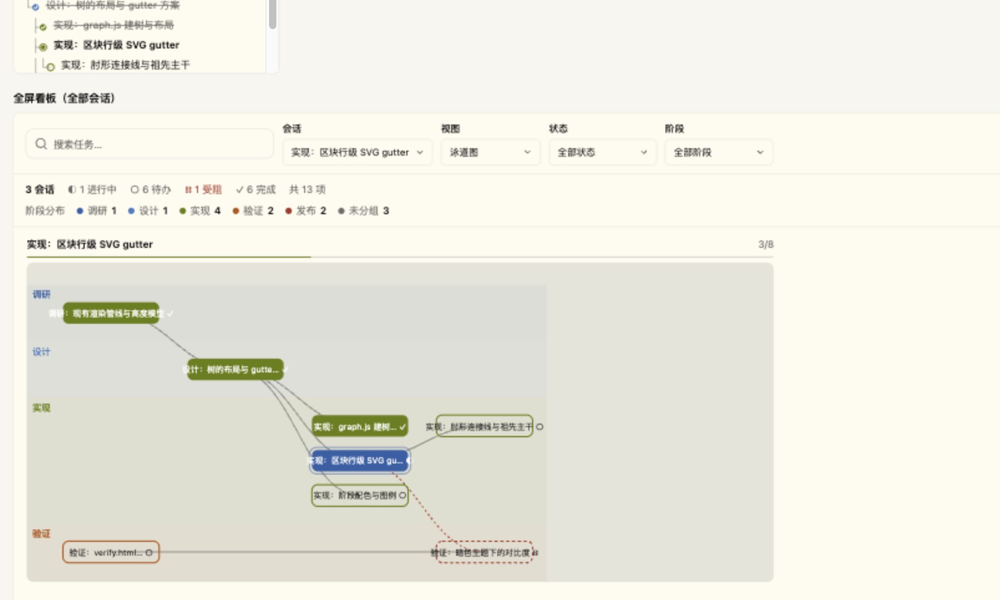

# OpenChamber Todo Bridge

[](https://github.com/blackkcold/openchamber-todo-bridge/releases)
[](LICENSE)


Visualize OpenCode todos in OpenChamber: a live task tree for the current session and a full-screen board for work across sessions. The agent owns the todo list; the UI is read-only.

| Work Status | Rail panel | Task board |
| --- | --- | --- |
|  |  |  |

## Features

- Restores `todowrite` / `todoread` for OpenCode v2 and displays session todos in OpenChamber.
- Groups nested tasks into a tree; `phase` adds colour-coded stages, and unfinished dependencies are marked blocked.
- Browse tasks across sessions as a work queue: sessions with open work first, blocked before in progress, then the rest; search, status/phase filters, and session archiving — one-click manual bulk archive of every finished session, and optionally automatic once a finished session passes an age threshold (7 days by default; configurable, 0–365).
- Session cards use the host's real chat title and show how long ago their task list moved; a card draws its first three open tasks (the current session stays expanded), and task details open in a drawer. Status and phase filters are answered from the index summary first, so they reach every session, not just the loaded window.
- Keeps the board readable as phase names accumulate: cosmetic folding, rule-based families (优先级 / 批次 / 质量 / 发版 / 界面 / 实现), count-sorted and collapsible chips, pinning, and a one-shot Small Model pass that groups the long tail — the model only ever sees a list of words, never a session.

## Install

In OpenChamber, open **Settings → Extensions**, paste this repository URL, select **Add**, and approve the requested permissions:

```text
https://github.com/blackkcold/openchamber-todo-bridge
```

Send a message in an OpenCode session to start using the todo tools. To pin a version, append a release tag such as `#v1.1.0` to the URL.

### v1.1.0 — a work queue, not an archive

The board now opens on unfinished work instead of the newest sessions. `待办` is the default scope; sessions are ordered blocked → in progress → most recently updated, while `全部` and `已完成` remain one click away. The pinned card is reserved for the open session, and a finished session is no longer mislabelled as current.

- Filters are real: only matching rows and the ancestors that lead to them are drawn, with a match count; the old dim-everything-else pass is gone. Status and phase filters are answered from the index summary first, so they reach every session rather than only the loaded window; text search states its loaded range.
- A session card uses the host's real chat title and task-update age, draws its first three open tasks (the current session stays expanded), and opens task details in a drawer. The summary stats are buttons, including a blocked filter and a clear button.
- The phase cloud lives in a filter panel anchored to the summary; the toolbar is one 47px row. The archive menu is a single `⋯` button. Rows are 28px, keyboard-navigable, and a broken mirror shows a retry card instead of an endless "loading".
- Dark-theme token contrast was audited; the pin tag now uses the host's `--oc-primary-fg` token.

Verification: `bun run build`, `bun run validate` and `bun run test` (15 suites) pass; the cache and context guards remain green. No prompt, tool-schema, reminder or index-write path changed.

### v1.0.2 — the bulk action comes back

v1.0.0 folded the manual bulk archive into the candidate popover and put the
same age threshold in front of it, so a session finished that morning was
neither counted nor offered: the toolbar said `归档候选 0` and the only bulk
button was disabled. The toolbar now carries `归档已完成 N` again — every session
with no open work, no age gate, one click, the same nine-second undo — while the
popover keeps the automatic sweep's own count and threshold. The two lists no
longer share a gate.

`blocked` now counts only open work. A completed task whose dependency was
cancelled used to keep a finished session out of every archive list and draw a
「受阻」pill on work that was already done; it no longer does. The index summary,
the task tree and the swimlane view agree again.

The plugin's mirror guard no longer trusts an in-memory signature after a
restart. A wiped mirror is rebuilt by the next identical `todowrite`, with the
original `updatedAt`, so the board stays populated without reordering the list
or resurfacing an archived session. The tool description, schema, reminder and
tool-result text are unchanged; the cache guards pin them with hashes.

### v1.0.1 — a switch to test the switch

The classification path had no way to be checked by hand: either it silently worked,
or the board fell back to the rules and said nothing useful. The board now carries an
explicit probe — 阶段分布 → **管理** → **Small Model · 测试连接** — which sends one
minimal request and prints what came back, including the error code in words
(`NO_MODEL`, `PERMISSION_DENIED`, `HOST_TIMEOUT`, …). It writes nothing, spends no
classification budget, and changes no gate.

That probe found a real limit: the page connected to the host with an 8-second request
timeout, and the SDK applies that timeout to every call — including `generate`, whose
own ceiling is 90 seconds. A slow Small Model could therefore never have answered.
The override is gone, so ordinary calls keep the SDK's 20 seconds and generation gets
its full 90.

### v1.0.0 — everything in its place

Finished sessions no longer leave the board only through a single "all finished"
rule. A finished session now has to pass an age threshold — seven days by default,
editable on the board, 0 to 365 — and the number of candidates sits on the toolbar
button itself. A session that is overdue but still has open work is **counted, never
swept**: hiding unfinished work is how work gets lost. Sessions with a blocked task
are left alone for the same reason. The old preference migrates to a threshold of 0,
so an upgrading reader sees exactly the behaviour they had.

Phase names accumulate: every session invents its own, and the board used to lay all
of them out side by side, half of them at zero. They are now folded first (full-width
characters, stray spaces and punctuation), then sorted into six families by rule —
优先级, 批次, 质量, 发版, 界面, 实现. Zero-count phases are hidden by default, the tail
collapses behind "+N 其他", a family chip drills into its own phases, and a chip is now
a filter rather than a statistic. Pins and ordering live in the extension's own
storage; nothing is written back to a mirror.

What the rules cannot place goes to OpenChamber's Small Model, once. It receives a
list of words — no session, no history, no tools, nothing that could touch a
conversation. Each batch is asked about once and the answer is frozen; the panel can
roll one version back. Four gates (unchanged batch, cooldown, daily cap, failure
backoff) plus a five-second idle window mean a quiet board spends nothing. This is the
`model` permission, and an upgrade asks for it once more; declining simply leaves the
tail in 其他.

### v0.9.9 — a ghost with a shape

A row that finishes in the task tree is cloned and flown to the finished toggle.
The clone was built from a row that no longer carried its `tree`, so it was drawn
as a flat row and went looking for the checkbox mark tree rows do not have. The
throw landed in the middle of the reconcile: the new rows were already inserted,
the old ones were not yet removed, and the change key had already been recorded.
The list kept a tail of rows from the previous write until something forced a
repaint — which the finished toggle did, and that is why opening and closing it
put the order back.

The paint now remembers the shape each node was drawn with and hands it to the
flight. A missing mark is skipped instead of thrown, one bad row can no longer
strand the rows queued behind it, and the change key is recorded only after a
paint that finished. A row that is already collapsing is never reused, so its
exit animation cannot take a live task with it.

Rows are identified by the task's stable `id` when it has one. Editing the wording,
or pruning one of two tasks that share a title, no longer hands a row — and with it
that row's depth, gutter and completion animation — to a different task. A tree row
also redraws its gutter when the tree around it moves, not only when its own status
or colour changes: a sibling added after the last child used to leave the old last
child's connector ending in mid-air.

Polling is two clocks now: 600 ms while the turn is in flight, 3 s once it is idle,
and nothing at all while the page is hidden. The board checks `_index.json`'s stat
before reading it, so a quiet poll never ships or parses the whole workspace index.
The plugin skips a `todowrite` whose list is byte-identical to the one already
written — no storage write, no mirror rename, no index rebuild, and the session does
not jump to the top of the board for a change nobody made. A failed mirror is still
retried by the next write, identical or not.

Measured in the section: 1 read per 4.5 s idle, 6 per 3.2 s while busy, 0 while
hidden and 1 on return; the board's index read stayed at 1 across a quiet 6 s while
its stat calls moved. The completion path is covered by a deterministic tree case
(a partial completion leaves 2 rows and no console error) and 10 randomised tree
lists (0 differences across an open/close of the finished fold). `bun run build`,
`bun run validate` and `bun run test` all pass.

### v0.9.8 — a progressive frost

The edge is a ramp now, not a step. Five sibling strips of 8px stack up a 40px band,
with the blur rising from 0.8px to 8px and the tint rising alongside, so a row goes
crisp, then soft, then unreadable, then gone across about two lines instead of snapping
from sharp to mush one line further down.

Two constraints shaped the markup, both measured rather than assumed. The strips cannot
nest: a parent carrying its own blur re-blurs its child's output, so the band doubles in
strength where layers overlap. And they cannot fade in: Chromium drops a layer's backdrop
blur while that layer is translucent, so the old 160ms opacity transition flashed a sharp
band before the blur landed. The edge therefore toggles with `display`, and its clearance
grew with it — 52px of bottom padding for the 40px band, so the last row still scrolls
clear at the end of the list.

The `data-more` flag, the tint fallback for hosts without `backdrop-filter`, and the
behaviour at the end of the list are unchanged.

### v0.9.7 — a frost you can actually see

0.9.6 drew the bottom edge with a mask that started fully transparent and only became
opaque at 82% of the 28px strip. A mask does not weaken a backdrop blur: it composites the
blurred layer at partial alpha over sharp rows. So for most of the strip the text stayed
sharp under a thin veil, and the edge read as a fade with no blur in it. Measured on the
rendered panel, horizontal gradient energy across the edge band was 47, against 124 for the
same rows with no frost at all.

The mask now starts at 45% alpha and reaches opaque by 45% of the strip, which leaves about
15px at full blur strength while the entry stays soft. The tint drops from 70% to 55% of the
host background, so the blurred rows remain visible instead of being swallowed by it. The
band now measures 3 in both themes — the same as an unmasked blur — and the strip no longer
opens on a hard line. Height, the 40px of bottom padding and the `data-more` clearing are
unchanged, as is everything else from 0.9.6.

### v0.9.6 — a frosted bottom edge on the list

The rail panel's list frosts its bottom edge while rows remain below: a 28px strip of
`backdrop-filter` blur with a mask that tapers upward, tinted from the host palette, so a
long tree dissolves into whatever sits beneath the panel instead of ending on a half-cut
row. The frost clears in 160ms once the reader reaches the end, and the list carries 40px
of bottom padding, so the last row always scrolls clear of it. Nothing is drawn when the
list fits without scrolling; `prefers-reduced-motion` makes the appearance instant, and a
host without `backdrop-filter` falls back to the tint alone, which still reads as a fade.

The flag lives on `#root[data-more]` and is refreshed on scroll, on rail resize, and after
every repaint — a taller list fires no scroll event, so the repaint hook is what keeps the
edge honest when the finished toggle expands the tree. The task board and the Work Status
section are untouched: at 56px tall, a frost there would eat half the section this panel
is meant to fit into.

Also fixes the 1px frame shortfall and refreshes the design preview pages.

### v0.9.5 — a finished toggle you can always reach

The finished toggle moved from the end of the list to the header of the Work Status
section and the rail panel, so it is reachable without scrolling however long the
list is. Turning it on reveals completed rows in place inside the tree; turning it
off removes them in one step, so the list height never animates twice.

While the toggle animates, the list holds the reader's place: a row that was
scrolled into view stays where it was. Finished rows still strike through before
they leave, and the flight to the toggle is drawn on its own overlay, so the scroll
container cannot clip it.

The control itself is a soft pill with the count in a badge, and its chevron is an
inline SVG, so the stroke stays crisp at 9px. The surface mixes `currentColor`,
which keeps it legible on both themes, and `prefers-reduced-motion` disables the
transitions. This release also fixes the label's spacing, where a flex `gap` split
`已完成 / 1 / 项` into three separate items, and the pill being clipped by the host
frame's rounded corner.

### v0.9.4 — cache safety and write reliability

The per-round reminder now carries stable task ids, parent links, dependencies
and the declared phase order, so a compaction cannot flatten the task tree or
lose the board's DAG edges. Omitting `phases` preserves the stored order; only an
explicit `phases: []` clears it.

Todo writes are serialized per session, so two `todowrite` calls in one assistant
turn cannot leave storage, the mirror and `_index.json` disagreeing. Index writes
are coalesced, use unique temp files and refresh a summary when a mirror's size
or contents change without an mtime move. A fault in the context reminder no
longer fails the model request; `todowrite` still fails loudly if it cannot read
the previous phase order when `phases` is omitted. `todowrite` returns a compact
open-list result and keeps the full render for a finished list, where no reminder
is injected.

The `todowrite` tool description and input schema are unchanged from 0.9.3, so
upgrading does not invalidate the tools prefix; only the runtime behavior and the
transient tail reminder change. The deterministic cache guard and the read-only
provider-cache audit are described under Cache verification below. No
cost-savings percentage is claimed.

### v0.9.3 — cache-friendly task context

Task reminders now live at the tail of the outgoing request instead of changing
the system prefix. Unchanged lists produce identical wording, without a growing
round counter. Reminders remain transient: no extra user turns are saved, and
finished lists add no reminder. Todo storage, mirrors, and the UI are unchanged.

This removes a source of prefix instability; provider cache hits and actual cost
savings still depend on the model, routing, and workload. No savings percentage
is claimed. Regression coverage checks stable system/history prefixes and
changed, finished, and empty lists.

## Compatibility & permissions

- OpenCode v2
- OpenChamber desktop or web, version 2.0.4 or later
- `filesystem` for todo data and the OpenCode plugin directory; `sessions` to open the session a task belongs to
- `model` is optional in practice: it lets the board ask OpenChamber's Small Model to group phase names the built-in rules could not place. It is one request per new batch of words, outside any session (no history, no tools), and the result is stored locally. Phase names are the only thing sent. Without it — or without a Small Model configured — the board falls back to the rules and says so once.

## Development

Requires [Bun](https://bun.sh/).

```bash
bun install
bun run validate
bun run test
bun run build
```

The built pages in `status/`, `panel/`, and `board/` are committed because OpenChamber installs them without building.

### Cache verification

`bun run test` includes `scripts/test-cache.mjs`, which guards the deterministic
half of prompt caching: system/tools/history prefixes stay unchanged, an
unchanged todo list produces byte-identical reminder text, the transient reminder
never becomes a persisted user turn, a storage fault does not fail the model
request, and reminder/tool-result sizes stay inside a bounded budget.

For real provider data, run:

```bash
bun run cache-audit -- --limit 10
bun run cache-audit -- --session ses_... --turns 200
```

It opens the local OpenCode SQLite database read-only and reports input, cache
read/write, output, cost and the cache-read share per session. It also flags
persisted reminders and prints the current reminder size for sessions with open
tasks. With `--session`, it prints the idle gap before each turn and flags a full
cache miss that follows a gap of five minutes or more: provider cache TTL expiry
can lower the hit rate even when the tools prefix is unchanged. A reminder is
injected only while a list has open work, so compare sessions that actually have
open tasks. Text stability alone is not a cache-hit claim; use this audit on the
target model before and after a change.

## License

[MIT](LICENSE)
